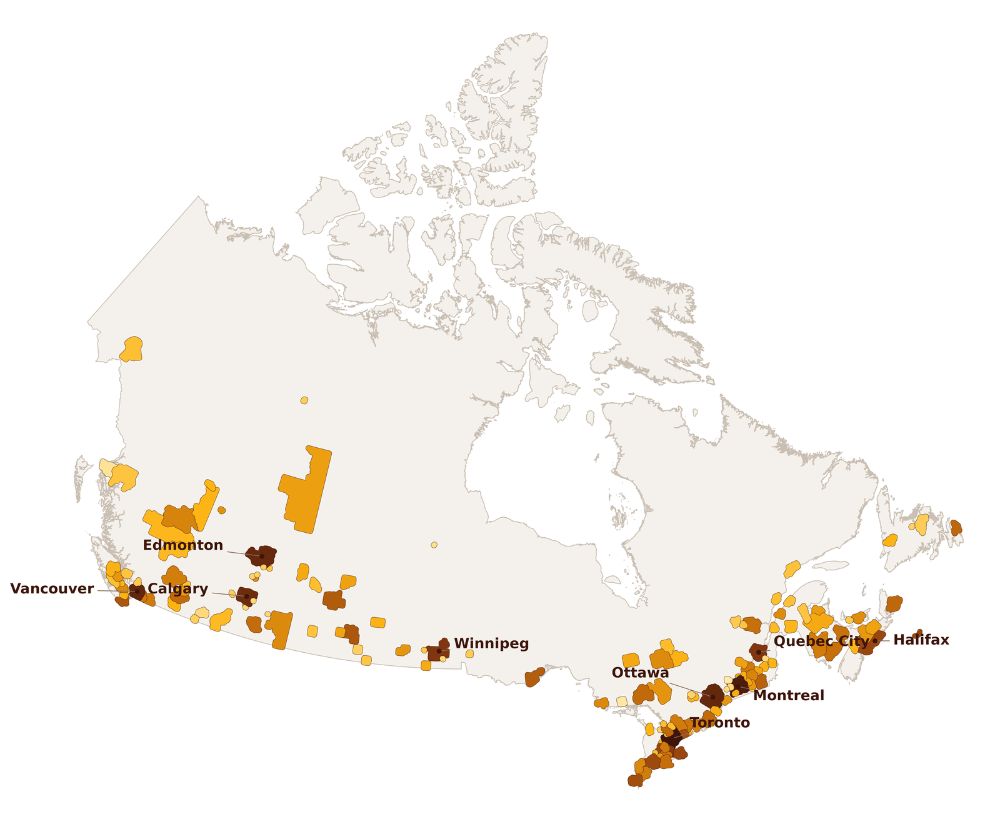
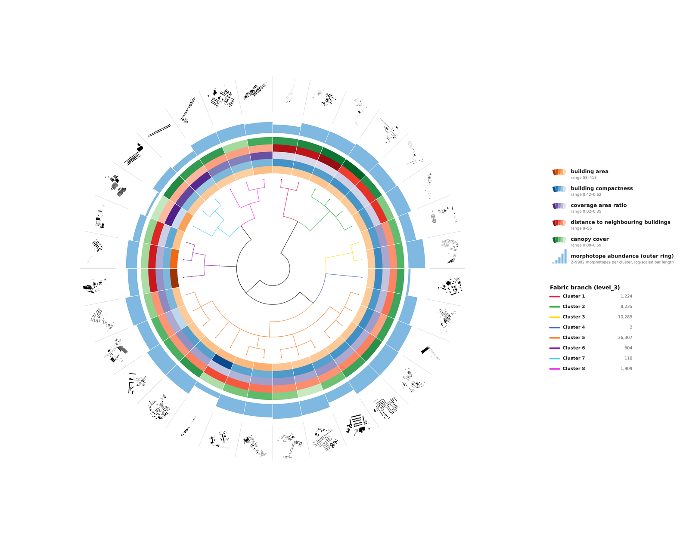
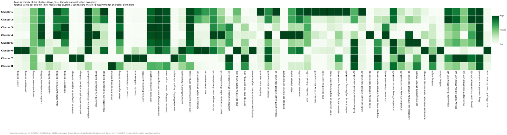
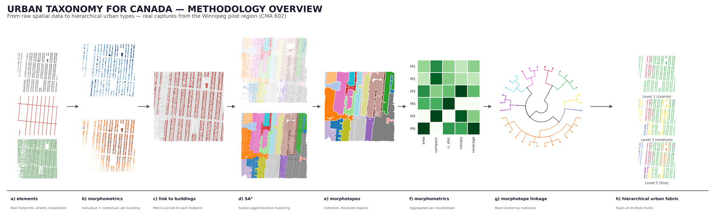
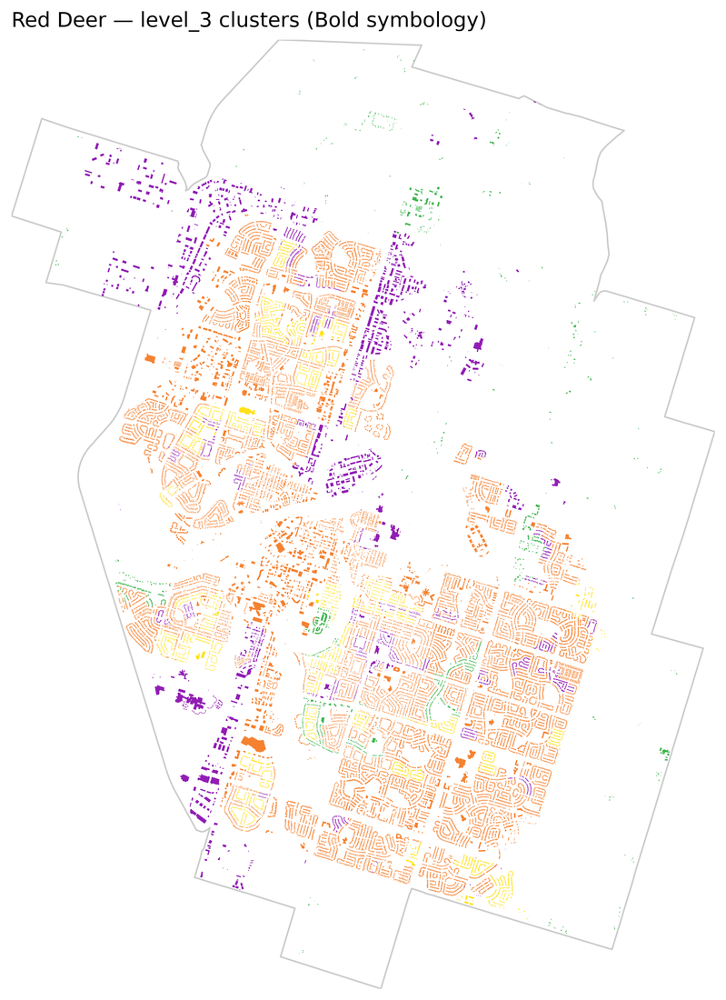
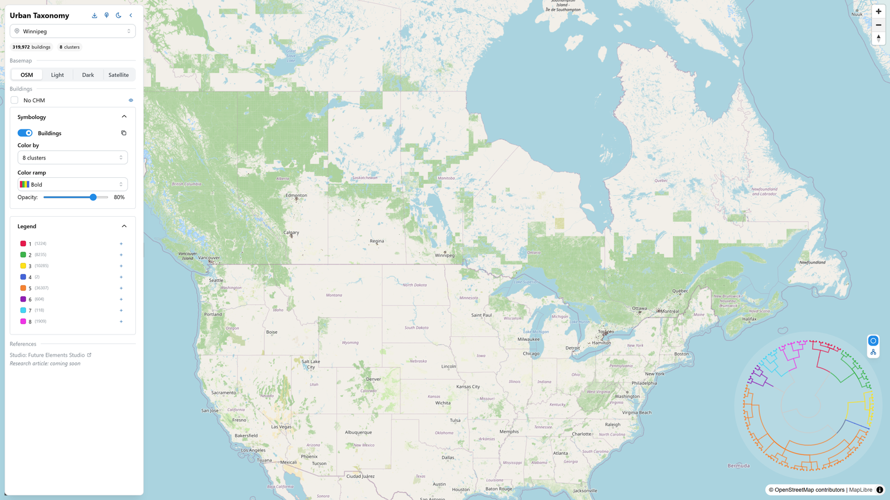

# Urban Taxonomy — Canada

A theory-driven, computationally scalable classification of Canada's built form: **152 Census Metropolitan Areas / Agglomerations, ~9.6 million buildings, 58,684 morphotopes**, organized into one shared national hierarchical taxonomy of urban fabric types.

This is a Canada-wide implementation of **Hierarchical Morphotope Classification (HiMoC)** — Fleischmann et al.'s theory-driven, unsupervised method for delineating and classifying urban form at country scale — extended with vertical form (building height, from Canada's open 3D building data) and vegetation structure (canopy height/cover, from Meta's Canopy Height Model), neither of which exist in the original European implementation.

[](#requirements)
[](#license)
[](#)

---

## Contents

- [What this is](#what-this-is)
- [Figures](#figures)
- [Method](#method)
- [Pipeline stages](#pipeline-stages)
- [Running it](#running-it)
  - [Config system](#config-system)
  - [CLI flags](#cli-flags)
  - [Country-scale, region-chunked runs](#country-scale-region-chunked-runs)
- [Output structure](#output-structure)
- [Data sources](#data-sources)
- [Other scripts](#other-scripts)
- [Web viewer](#web-viewer)
- [Poster & figure-generation scripts](#poster--figure-generation-scripts)
- [Requirements](#requirements)
- [Citation](#citation)
- [Credits](#credits)
- [License](#license)

---

## What this is

Urban form — the layout of buildings, streets and plots — shapes how cities function and are experienced, but classifying it consistently across a country-sized area has historically required trading off theoretical grounding, spatial detail, or scale. This project applies **HiMoC** (Fleischmann, Samardzhiev, Brázdová, Dančejová & Winkler, 2026) to Canada:

1. Delineate **morphotopes** — the smallest urban locality with a distinctive character (Conzen, 1988) — as spatially contiguous, morphologically homogeneous groups of buildings, using a bespoke regionalization method, **SA³ (Spatial Agglomerative Adaptive Aggregation)**.
2. Link morphotopes into a **hierarchical taxonomic tree** by Ward's agglomerative clustering on their aggregated morphometric profile, cut at 7 levels of granularity (2 → 128+ named/unnamed clusters).
3. Do this for **the whole country** by chunking the computation over Statistics Canada's CMA/CA boundaries, clustering once on the pooled national dataset, and mapping the shared taxonomy back onto every region.

Two parallel taxonomies are produced: one including canopy structure (`outputs_canada_cma_ca/`) and one without it (`outputs_canada_cma_ca_nochm/`), so the effect of adding vegetation to the classification can be inspected directly.

## Figures

### National coverage
Every filled region below is a CMA/CA this pipeline has classified — 152 in total, shaded by building count.



### Radial taxonomy wheel
The national taxonomy tree (root → level 5, 32 leaves), coloured by fabric type, with five morphometric character rings, a morphotope-abundance ring, and one real, adaptively-sampled building-footprint silhouette per leaf. Composited here from the wheel plus its two legend images (`poster_presentation/assets/figures/radial_taxonomy.png`, `legend_wheel_rings.png`, `legend_wheel_branches.png`) via `scripts/build_readme_radial_composite.py` — a compositing-only script that does not touch or regenerate any of the source figures.



### Feature matrix
Relative morphometric profile (min–max normalized per column) of the 8 top-level fabric clusters across all 61 characters used in clustering — see `poster_presentation/feature_matrix_glossary.md` for exactly what "low"/"high" mean and why 61 (not 59, 72, or 65).



### Methodology, illustrated with real data
Every panel below is a real capture from the Winnipeg pilot region — not a schematic — carried through elements → morphometrics → linking → SA³ → morphotopes → aggregated characters → the national dendrogram → the resulting hierarchical fabric, at one consistent neighbourhood window (with real whole-city cluster maps for the final stage).



### One city, classified
Real buildings in Red Deer, AB, coloured by their national `level_3` cluster (8 fabric types) — every city in the study area gets one shared taxonomy, so this map is directly comparable to the same view of any other Canadian city.



### Interactive web viewer
The full national classification — every hierarchy level, with and without canopy data — is explorable live: pan/zoom any Canadian city, recolour by any level of the taxonomy, and trace a single building's classification up the tree in a live radial dendrogram.



## Method

| Step | What happens | Key libraries |
|---|---|---|
| **a) Elements** | Building footprints (polygons) + street network (lines) as the only two required inputs | `geopandas`, `pyogrio` |
| **b) Morphometrics** | ~70 morphometric characters computed per building/street/tessellation cell, at 3 scales (element, neighbourhood, 5-topological-neighbour) and 2 subsets (individual, contextual) | `momepy`, `libpysal.graph` |
| **c) Link to buildings** | Generated *enclosed tessellation* (a Voronoi-like polygon per building, bounded by streets and a variable bandwidth) joins every character onto a common spatial unit | `momepy` (buffered limit, tessellation) |
| **d) SA³** | Spatially-constrained Ward agglomerative clustering restricted to a tessellation contiguity graph, with density-based ("leaf") flat-cluster extraction — admits noise, needs no target cluster count a priori, only a minimum morphotope size (75 buildings, chosen empirically) | `scikit-learn`, `fast_hdbscan`, `libpysal.graph` |
| **e) Morphotopes** | The resulting spatially coherent, morphologically distinct regions — Canada's version of Conzen's morphotope, delineated computationally instead of from historical maps | — |
| **f) Morphotope morphometrics** | Morphotope-level attributes aggregated (median) from their constituent cells, plus 3 morphotope-specific shape indicators (`limLPS`, `limAre`, `limPer`) | `momepy`, `shapely` |
| **g) Morphotope linkage** | Ward's agglomerative clustering **in feature space only** (no spatial constraint) on a 10-nearest-neighbour graph, producing the taxonomic tree — cut at 7 named/unnamed levels | `scikit-learn` |
| **h) Hierarchical urban fabric** | The tree, cut at any level, gives urban fabric types at that granularity — from 2 coarse types down to 128+ fine ones — mapped back onto every building in the country | — |

Noise buildings (below the SA³ minimum-size threshold) are grouped into contiguous "noise pseudo-morphotopes" and assigned to the nearest taxonomy branch via a k-NN classifier trained on cluster centroids (`10_noise.ipynb`) rather than discarded.

## Pipeline stages

The pipeline is 12 phases, each a notebook in `notebooks_buidings/`, executed in place by `scripts/run_pipeline_buildings.py` via `jupyter nbconvert`. Every notebook loads its inputs/config through `scripts/pipeline_config.py` — switching study areas means pointing at a different `config/*.env` file, never editing a notebook.

| # | Notebook | Purpose | Output folder |
|---|---|---|---|
| 1 | `01_preprocess.ipynb` | Load & clean building footprints and streets, reproject to a local metric CRS, fix geometry/attribute issues | `01_preprocessed/` |
| 2 | `02_tessellation.ipynb` | Generate enclosures (Gabriel-triangulation-based adaptive buffer) and run enclosed morphological tessellation | `02_tessellation/` |
| 3 | `03_graphs.ipynb` | Build 5 spatial contiguity graphs (tessellation, building, street, enclosure, node) | `03_graphs/` |
| 4 | `04_morphometrics.ipynb` | Compute ~70 primary morphometric characters (+ Canadian HEIGHT/volume, + CHM canopy stats when enabled) | `04_chars/` |
| 5 | `05_merge_chars.ipynb` | Merge all character tables into one, indexed by tessellation cell | `05_primary_chars/` |
| 6 | `06_morphotopes.ipynb` | **SA³**: quantile-transform characters, spatially-constrained Ward clustering, leaf-based flat extraction | `06_morphotopes/` |
| 7 | `07_morphotope_postprocessing.ipynb` | Ensure connected building components aren't split across morphotope labels | `06_morphotopes/` |
| 8 | `08_morphotope_chars.ipynb` | Morphotope-level shape indicators (`limLPS`, `limAre`, `limSDi`, ...) | `08_morphotope_chars/` |
| 9 | `09_clustering.ipynb` | Scale features, build a KNN(k=10) graph, Ward-cluster morphotopes into the taxonomic tree, cut at 7 levels | `09_hierarchy/` |
| 10 | `09b_map_to_cells.ipynb` | Map the (possibly globally-pooled) taxonomy back onto this region's tessellation cells | `09_hierarchy/` |
| 11 | `10_noise.ipynb` | Assign noise morphotopes to the nearest taxonomy branch via k-NN classification | `09_hierarchy/`, `06_morphotopes/` |
| 12 | `11_export.ipynb` | Dissolve cells into morphotope polygons, attach labels to every building, export GeoJSON/GPKG/CSV | `11_exports/` |

## Running it

```powershell
# Full run, default config (config/winnipeg.env)
.venv\Scripts\python.exe scripts\run_pipeline_buildings.py

# Full run for a named city config (config/calgary.env)
.venv\Scripts\python.exe scripts\run_pipeline_buildings.py --city calgary

# Point at an arbitrary config file
.venv\Scripts\python.exe scripts\run_pipeline_buildings.py --config config/calgary.env

# Re-run only a subset of phases (e.g. clustering onward)
.venv\Scripts\python.exe scripts\run_pipeline_buildings.py --start 9 --end 12

# Override the CHM toggle from the config file for this run only
.venv\Scripts\python.exe scripts\run_pipeline_buildings.py --no-chm

# The actual national production run (region-chunked, resumable, no timeout)
.venv\Scripts\python.exe scripts\run_pipeline_buildings.py --config config/canada_cma_ca.env --regions-shapefile data\CMA_CA_boundaries.gdb --region-id-col CMAUID --timeout -1
```

Re-running the exact same region-chunked command after an interruption automatically skips any region/phase whose output already exists on disk.

### Config system

Every `config/*.env` file sets the same variables (see `config/template.env` for the full annotated list):

```env
CITY_NAME=YourCity
CITY_SLUG=yourcity
TARGET_CRS=EPSG:XXXX          # projected, metres, local to the study area

BUILDINGS_FILE=data/yourcity_buildings.gpkg
BOUNDARY_FILE=data/yourcity_boundary.gpkg
ROADS_FILE=data/yourcity_roads.gpkg
ROAD_CLASS_COL=fclass

INCLUDE_CHM=0                 # 1 to compute canopy characters
CHM_COLS=chm_mean,chm_std,chm_max,chm_cover

SIMPLIFICATION_TOLERANCE=0.1
MERGE_LIMIT=25
MAX_BUILDING_AREA=200000

OUTPUT_ROOT=outputs_yourcity
```

Real environment variables always take precedence over the file — `pipeline_config.load_city_config()` only fills in values not already set, so `run_pipeline_buildings.py` can override `OUTPUT_ROOT`/`INCLUDE_CHM` per-run without editing any file.

Configs shipped in this repo: `winnipeg.env` (single-city pilot), `canada.env` (full-country, no CHM), `canada_cma_ca.env` / `canada_cma_ca_nochm.env` (the actual national production runs, CMA/CA-chunked, with/without canopy), plus a handful of other single-city configs (`halifax`, `kitchener`, `moncton`, `oshawa`).

### CLI flags

`scripts/run_pipeline_buildings.py`:

| Flag | Default | Meaning |
|---|---|---|
| `--start INT` | `1` | First phase to run (1–12) |
| `--end INT` | `12` | Last phase to run (1–12) |
| `--city STR` | — | Shorthand for `--config config/<city>.env` |
| `--config STR` | `config/winnipeg.env` | Path to a config `.env` file |
| `--output-root STR` | — | Override `OUTPUT_ROOT` from the config for this run |
| `--chm` / `--no-chm` | from config | Force-include/exclude CHM canopy attributes, overriding the config |
| `--timeout INT` | `3600` | Per-notebook execution timeout in seconds; `-1` disables it |
| `--regions-shapefile STR` | — | Polygon shapefile/GeoPackage of sub-regions — switches to region-chunked mode |
| `--region-id-col STR` | `id` | Column in `--regions-shapefile` holding each region's unique id |
| `--buffer-m FLOAT` | `500.0` | Metres to buffer each region's boundary before clipping (avoids truncating context at the edge; buffer-only buildings are dropped again at merge via `core_mask.parquet`) |
| `--no-resume` | resume=on | Force a clean rebuild instead of skipping already-completed region/phase checkpoints |

`--city` and `--config` are mutually exclusive.

### Country-scale, region-chunked runs

A single unified tessellation + graph + SA³ run does not scale to a country the size of Canada (13.7M buildings) — phases 2/3/6 scale worse than linearly and exceed available memory. `scripts/region_pipeline.py` instead:

1. Splits the study area into regions — **CMA/CA polygons**, specifically, because they don't cut through continuous urban fabric the way provinces or census divisions would.
2. Runs phases 1–8 **independently per region** (each region's boundary buffered outward first, so tessellation/graph context isn't truncated at the edge).
3. Pools every region's morphotope characteristics into one table and clusters **once**, globally (phase 9) — so morphotope labels are comparable everywhere in the country.
4. Maps that one shared taxonomy back onto each region's own tessellation cells (phase 9b) and runs phases 10–11 per region.
5. Merges everything into a final country-wide export.

## Output structure

```
outputs_canada_cma_ca/
└── regions/
    └── <CMAUID>/                    # e.g. 602 = Winnipeg
        ├── 01_preprocessed/         buildings.gpkg, roads.gpkg, boundary.gpkg
        ├── 02_tessellation/         tessellation.parquet, enclosures.parquet
        ├── 03_graphs/               *_graph.parquet (tessellation/building/street/enclosure/node)
        ├── 04_chars/                *_chars.parquet (per-layer morphometric characters)
        ├── 05_primary_chars/        primary_chars.parquet (merged)
        ├── 06_morphotopes/          tessellation_labels_(postprocessed).parquet — SA³ output
        ├── 08_morphotope_chars/     morph_chars.parquet — morphotope-level shape indicators
        ├── 09_hierarchy/            cdata.parquet, cluster_mapping.parquet (level_1..level_7),
        │                            tessellation_clusters_final.parquet
        └── 11_exports/              GeoJSON, GeoPackage, taxonomy_hierarchy.json, summary_stats.csv
```

`outputs_canada_cma_ca_nochm/` mirrors this exactly, from `config/canada_cma_ca_nochm.env` (`INCLUDE_CHM=0`).

## Data sources

| Data | Source | Notes |
|---|---|---|
| Building footprints, height, population | **Open Building Population Layer — Canada v3 (OBPL-CA-v3)**, [maximfortin.com/project/obpl-ca-v3](https://maximfortin.com/project/obpl-ca-v3/) | Derived from Canada Structures (Public Safety Canada), the Open Database of Buildings (Statistics Canada), OSM buildings, and Microsoft Building Footprints. ODbL. |
| Street network | **OpenStreetMap**, Geofabrik Canada extract | `data/ca_streets.gpkg` |
| Canopy height & cover | **Meta Canopy Height Model v2** | Aggregated in a buffer around each building; produces `chm_mean`/`chm_std`/`chm_max`/`chm_cover` |
| CMA/CA boundaries | **Statistics Canada** Census Metropolitan Area / Census Agglomeration boundaries | Used both as the study-area definition and the region-chunking scheme for the national run |

The absence of building height in the original European study was a deliberate simplification (2D form is argued to largely capture height information); this Canadian implementation adds it anyway, since OBPL-CA-v3 makes it available, along with vegetation structure that has no European equivalent in the source method at all.

## Other scripts

| Script | Purpose |
|---|---|
| `app.py` | Flask server exposing the generated PMTiles archives (`tiles/` with CHM, `tiles_nochm/` without) to the web viewer, with Range/ETag support and a small CORS allowlist |
| `scripts/build_cma_ca_buildings_chm.py` | One-off join of the separate CHM computation output back onto full OBPL building attributes, producing the buildings file used by the CMA/CA production configs |
| `scripts/export_region_geojsonl.py` | Exports every completed region's buildings to GeoJSONSeq, ready for `tippecanoe` tiling |
| `scripts/build_merged_pmtiles.sh` | Merges per-region PMTiles into one country-wide archive (fresh low-zoom overview + `tile-join` with existing high-zoom tiles) |
| `scripts/generate_global_cluster_summary.py` | Builds the small, region-independent cluster-hierarchy summary used for the viewer's legend/symbology |
| `scripts/generate_tree_json.py` | Converts the scipy linkage matrix + cluster mapping into a D3-compatible hierarchy tree JSON |
| `scripts/generate_web_data.py` | Quantized (coordinate-precision-only, no simplification) GeoJSON export for the web viewer |
| `scripts/build_readme_radial_composite.py` | Composites the existing radial wheel + legend images into this README's figure — no regeneration of source figures |

## Web viewer

[`urban_taxonomy_viewer`](../urban_taxonomy_viewer/) is a companion React 19 + TypeScript + Vite app that renders this pipeline's output as an interactive dashboard: a MapLibre GL map of building/morphotope layers, a D3 dendrogram of the cluster hierarchy in three layouts (circular, vertical, geographic), fixed-count and percentile dendrogram cuts, multi-cluster filtering, zoom-to-cluster, and 18+ color ramps. It reads the FlatGeobuf/GeoJSON/PMTiles and hierarchy JSON files this pipeline produces. See its own README for setup.

## Poster & figure-generation scripts

`poster_presentation/` holds a 40"×60" print poster (built for the University of Manitoba Undergraduate Research Showcase) and, more reusably, the **standalone Python scripts that generate every figure in it** — each one reads directly from a region's real pipeline outputs, so they double as a worked example of consuming this repo's data:

- `build_radial_rings.py` — the radial taxonomy wheel (dendrogram + character rings + real footprint samples)
- `build_radial_dendrogram.py` — a standalone circular dendrogram, ported 1:1 from the web viewer's own D3 layout
- `build_radial_legends.py` / `build_radial_legend_wheel.py` — character and abundance-ring legends
- `build_feature_matrix.py` — the cluster × character heatmap
- `build_methodology_diagram.py` — the real-data methodology flow diagram
- `build_city_cluster_maps.py` — per-city building/morphotope maps by cluster, given a CMAUID

All produce print-quality (400dpi) output; several also emit SVG/PDF for lossless scaling.

## Requirements

Python 3.11+, a `.venv` at the repo root. Core dependencies: `geopandas`, `pyogrio`, `momepy`, `libpysal`, `scikit-learn`, `fast_hdbscan`, `shapely`, `pandas`, `numpy`, `matplotlib`, `flask`, `jupyter`. GIS tooling for the web pipeline: `tippecanoe` (via WSL) for PMTiles generation.

## Citation

This project applies the method described in:

> Fleischmann, M., Samardzhiev, K., Brázdová, A., Dančejová, D., & Winkler, L. (2026). The hierarchical morphotope classification: A theory-driven framework for large-scale analysis of built form. *Cities*, 174, 107047. https://doi.org/10.1016/j.cities.2026.107047

which itself builds on the original Urban Taxonomy methodology:

> Fleischmann, M., Feliciotti, A., Romice, O., & Porta, S. (2022). Methodological foundation of a numerical taxonomy of urban form. *Environment and Planning B: Urban Analytics and City Science*, 49(4), 1283–1299. https://doi.org/10.1177/23998083211059835

```bibtex
@article{fleischmann2026himoc,
  title   = {The hierarchical morphotope classification: A theory-driven framework for large-scale analysis of built form},
  author  = {Fleischmann, Martin and Samardzhiev, Krasen and Br{\'a}zdov{\'a}, Anna and Dan{\v{c}}ejov{\'a}, Daniela and Winkler, Lisa},
  journal = {Cities},
  volume  = {174},
  pages   = {107047},
  year    = {2026},
  doi     = {10.1016/j.cities.2026.107047}
}
```

## Credits

**Team** — Yuhao Lu (Professor, University of Manitoba, Supervisor); AbdurRehman Goheer, Hassibe Gómez, Jaqueline de la Cruz (Faculty of Architecture, University of Manitoba).

**Key libraries** — [momepy](https://momepy.org/), [PySAL](https://pysal.org/) / [libpysal](https://pysal.org/libpysal/) / [spopt](https://pysal.org/spopt/), [scikit-learn](https://scikit-learn.org/), [GeoPandas](https://geopandas.org/).

## License

Academic use. Please cite both papers above, and this project, when using the methodology, code, or results.
